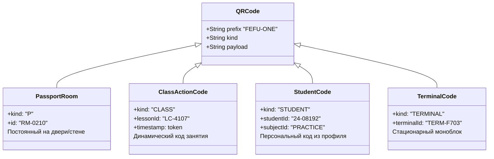
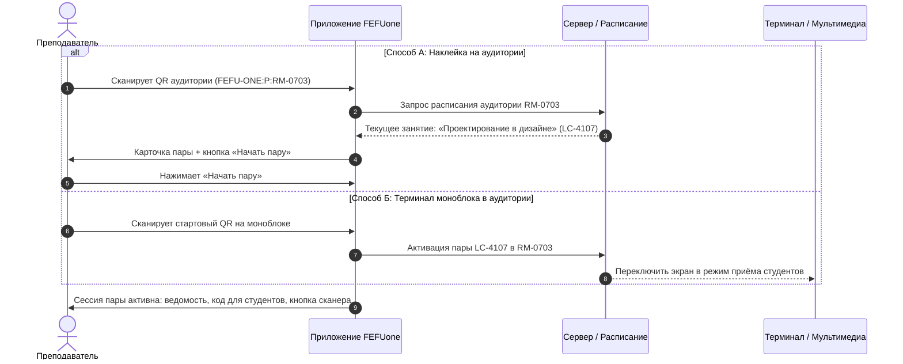
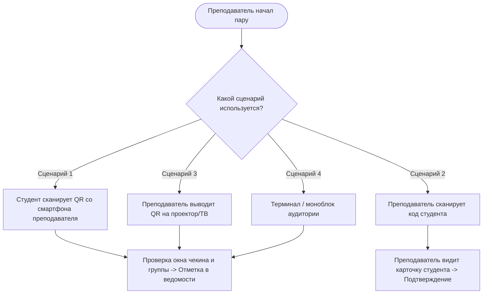
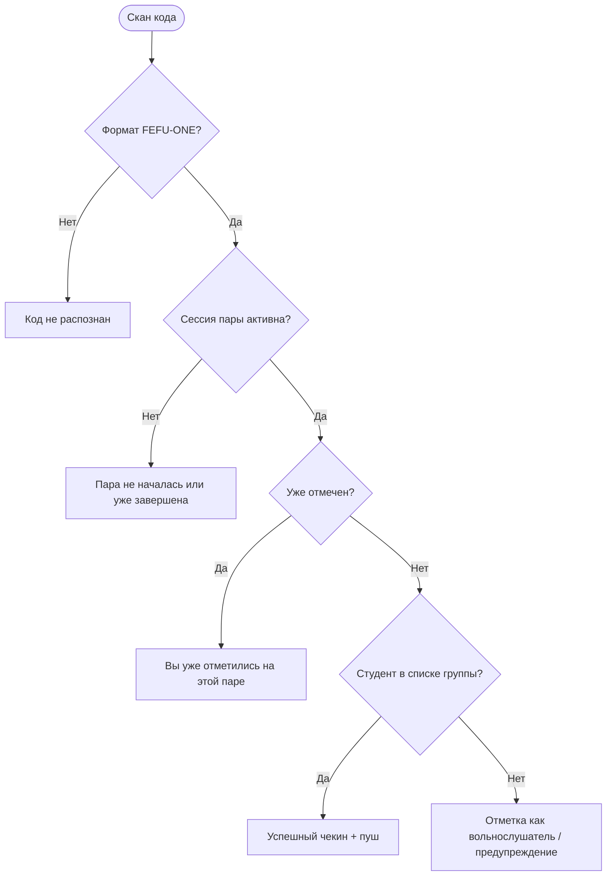

# Логика чекина на занятиях через QR-коды в FEFUone

Документ описывает архитектуру, сценарии, форматы QR-кодов, жизненный цикл и логику валидации для отметки присутствия студентов и преподавателей на учебных занятиях.

---

## 1. Общая концепция и роли

Система чекина решает две основные задачи:
1. **Подтверждение присутствия преподавателя и старт занятия в аудитории.**
2. **Фиксация присутствия студентов на паре** одним из гибких способов в зависимости от оснащения аудитории.

### Роли и полномочия

| Роль | Действие в сценарии | Что сканирует | Что показывает |
|---|---|---|---|
| **Преподаватель** | Открывает аудиторию, стартует занятие, принимает отметки | Паспорт аудитории, QR терминала моноблока, QR-коды студентов | QR занятия (на смартфоне / через проектор) |
| **Студент** | Отмечается на паре | QR занятия (с проектора, смартфона преподавателя или моноблока) | Свой персональный студенческий QR |
| **Терминал (моноблок аудитории)** | Стационарный интерфейс в аудитории | — (интерактивный экран) | QR старта для преподавателя $\to$ QR чекина для студентов |

---

## 2. Форматы QR-кодов (Payload)

Все коды строятся по стандарту FEFUone: `FEFU-ONE:<ТИП>:<ПАРАМЕТРЫ>`.

1. **Паспорт помещения (постоянный):**
   - Формат: `FEFU-ONE:P:<ROOM_ID>` (например, `FEFU-ONE:P:RM-0703`).
   - Носитель: физическая наклейка на входе в аудиторию с коротким номером (`RM-0703`).
2. **Код занятия (динамический код действия):**
   - Формат: `FEFU-ONE:CLASS:<LESSON_ID>[:TOKEN]` (например, `FEFU-ONE:CLASS:LC-4107`).
   - Время жизни: ограничен текущей парой + интервал чекина (например, открывается за 15 минут до пары и действует до конца занятия).
   - Токен (опционально): динамический хэш с ротацией каждые 15–30 секунд для защиты от пересылки фото QR в мессенджерах.
3. **Персональный код студента (динамический / профильный):**
   - Формат: `FEFU-ONE:STUDENT:<STUDENT_ID>[:SUBJECT_ID]` (например, `FEFU-ONE:STUDENT:24-08192:PRACTICE`).
   - Отображается в приложении студента в шторке студенческого билета на главной странице.
4. **Код терминала аудитории (стационарный / моноблок):**
   - Формат: `FEFU-ONE:TERMINAL:<ROOM_ID>` или `FEFU-ONE:P:<ROOM_ID>`.

---

## 3. Старт пары преподавателем

Преподаватель запускает занятие одним из двух способов:

### Шаги старта:
1. Преподаватель открывает единый сканер FEFUone.
2. Наводит камеру на паспорт аудитории (`RM-...`) или экран моноблока.
3. Сканер определяет, что это помещение с привязанным расписанием, сопоставляет текущее время и аккаунт преподавателя.
4. Открывается модальное окно пары:
   - Название дисциплины, группа, время пары, список студентов.
   - Кнопка **«Начать пару»**.
5. После нажатия создаётся активная сессия занятия:
   - Генерируется код действия `CLASS`.
   - Включается приём чекинов.

---

## 4. Четыре сценария чекина студентов

### Сценарий 1: Студент сканирует QR занятия с устройства преподавателя
- **Где код:** На экране смартфона или планшета преподавателя в окне активной сессии пары.
- **Действие:** Студент подходит к столу преподавателя, открывает сканер в своём приложении и считывает `FEFU-ONE:CLASS:...`.
- **Результат:**
  - У студента: подтверждение отметки с карточкой предмета, аудитории и временем.
  - У преподавателя: статус студента в ведомости меняется на «Присутствует».

### Сценарий 2: Преподаватель сканирует студенческий код
- **Где код:** У студента на смартфоне открыта шторка студенческого билета с главной страницы (`FEFU-ONE:STUDENT:<ID>`).
- **Действие:**
  - Преподаватель в окне сессии пары нажимает кнопку **«Сканировать студента»** (запускается сканер в режиме потокового чекина).
  - Преподаватель последовательно наводит камеру на экраны студентов.
- **Результат:** Камера не закрывается после каждого скана, а выдаёт быстрый тактильный/звуковой отклик: «Иванов И. — отмечен». Студенты один за другим добавляются в список.

### Сценарий 3: Вывод QR-кода занятия через мультимедиа (проектор / экран)
- **Где код:** На большом проекторе или ТВ в аудитории.
- **Действие:**
  - Преподаватель нажимает кнопку **«Вывести на экран»** (открывается веб-страница трансляции или режим полного экрана).
  - На проекторе крупно отображается QR-код занятия с названием предмета, таймером и динамическим обновлением токена.
  - Студенты со своих рабочих мест в аудитории сканируют код камерой телефона.
- **Результат:** Массовый одновременный чекин всей аудитории без очередей у преподавательского стола.

### Сценарий 4: Терминал (моноблок) аудитории
- **Где код:** На интерактивном моноблоке, установленном на кафедре или при входе в аудиторию.
- **Двухфазный жизненный цикл:**
  1. **Фаза ожидания (для преподавателя):** Моноблок показывает статус аудитории и приглашение: *«Отсканируйте для начала пары»* с кодом помещения/терминала.
  2. **Активация:** Преподаватель сканирует код моноблока своим приложением. Моноблок связывается с сервером, определяет пару преподавателя и автоматически переходит в режим пары.
  3. **Фаза чекина (для студентов):** На экране моноблока появляется крупный QR-код занятия и счётчик отметившихся студентов («Отметились: 18 / 24»).
  4. Студенты считывают QR с экрана моноблока и получают отметку.
  5. По окончании пары преподаватель нажимает на моноблоке или в телефоне «Завершить пару», и экран возвращается в режим ожидания.

---

## 5. Валидация и обработка ошибок

Каждый скан проходит конвейер проверок:

| Код ошибки / статус | Причина | Что видит пользователь |
|---|---|---|
| `unrecognized` | Код сторонней системы или повреждён | «Код не распознан. Попробуйте ещё раз.» |
| `inactive` | Пара ещё не открыта преподавателем или окончена | «Занятие не начато или окно чекина закрыто.» |
| `already-checked` | Повторный скан того же занятия | «Вы уже отметились на этой паре в 10:15.» |
| `wrong-group` | Студент сканирует пару другой группы | «Вы не числитесь в группе этой пары. Отметиться как присутствующий?» |
| `forbidden` | Студент сканирует закрытый служебный код | «Нет доступа к этой операции.» |

---

## 6. Данные и хранение состояния

1. **Модель пары (`lessons` / `session`):**
   - `id`: уникальный идентификатор занятия (`LC-4107`).
   - `roomId`: идентификатор аудитории (`RM-0703`).
   - `title`: название дисциплины.
   - `teacher`: ФИО преподавателя.
   - `group`: академическая группа.
   - `status`: `'scheduled' | 'active' | 'finished'`.
   - `startedAt`, `finishedAt`: временные метки.
   - `attendees`: массив отметившихся студентов `[{ studentId, name, checkedAt, method }]`, где `method` — `'class-qr'`, `'teacher-scan'`, `'multimedia'`, `'terminal'`.

2. **Студенческий журнал (`classMarks`):**
   - Локальная и серверная запись о чекине студента с привязкой к паре и времени.
   - Отображение статуса в виджете расписания на главной странице студента («Отмечен на паре»).
